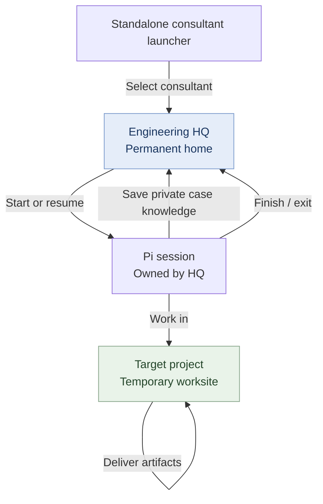

# Milestone A — Standalone engineering consultant arrival

**Status:** Experimental source-checkout proof. It adds a standalone launch command, not a Pi extension installed globally. No new backend, HQ migration, or visit database.

## Architecture

**Specialists own their reusable expertise. Missions own their work and decisions. Runs own temporary execution state.**

A consultant lives at HQ, temporarily visits a project, and leaves project work there while its private cases and Pi session remain at HQ.



The *resume* arrow represents the overall product direction; Milestone A creates **new** sessions only. Session browsing and returning to an existing conversation belong to Milestone B.

## Use from the source checkout

Requires an existing engineering HQ created with `npm run setup`, Node >=24.15, installed and authenticated Pi >=1.2, and a terminal. These commands are proposed proof commands, not a published package.

```sh
# Launch engineering in a project from any directory
node /path/to/pi-consultants/bin/pi-consultants.mjs engineering --project /path/to/project

# Or, from inside a recognizable project
node /path/to/pi-consultants/bin/pi-consultants.mjs engineering

# Visit from an external existing engineering HQ without copying it
node /path/to/pi-consultants/bin/pi-consultants.mjs engineering --hq /path/to/HQ --project /path/to/project

# Start ordinary Pi inside the HQ with no project
node /path/to/pi-consultants/bin/pi-consultants.mjs engineering --office-only

# Inspect what would launch; does not start Pi or write any files
node /path/to/pi-consultants/bin/pi-consultants.mjs engineering --project /path/to/project --plan
```

`npm link` in this checkout creates a local `pi-consultants` executable as a convenience; it does **not** install a global Pi extension. Publishing and installing an npm distribution, plus lazy office creation, belong to Milestone C.

## Startup behavior

1. Validate that the selected path is an existing engineering HQ (`HQ-ROLE.json`, `.pi/hq.json`, instructions, and native extension). No private HQ data is copied, migrated, or edited.
2. Select the worksite explicitly with `--project`, or infer the caller's current directory only when project markers exist. When ambiguous, refuse and suggest `--project` or `--office-only`. Reject the HQ itself as a project.
3. Check Node and Pi versions and spawn **native Pi with cwd = HQ**, `--session-dir <HQ>/.hq/sessions`, a fresh `--session-id`, and a user-visible session name. Global Pi authentication and extensions remain normal.
4. For a project visit only, add one explicitly loaded startup bridge through Pi's `--extension`. It asks the HQ's pinned `pi-change-working-dir` extension to set the effective tool directory using its public `pi-change-working-dir:set-execution-cwd` event.
5. On success, Pi itself records the directory change on the session branch, and the bridge records a small arrival marker in that same native session. No extra session database or daemon exists.
6. If the directory owner is missing or rejects the path, the bridge blocks model tool calls and the supported user shell hook rather than silently executing at HQ. It retries at the first turn to handle startup ordering, and does not grant new filesystem permissions.
7. On exit, the transcript stays under HQ and work products stay at the project. It does not auto-create cases, close engagements, promote lessons, or publish deliverables.

## Resource behavior and explicit limits

**HQ stays the native Pi project.** This means the specialist's instructions, local tools, skills, connectors, and private case records remain attached to HQ. The worksite becomes the effective directory for supported built-in execution tools.

**Project `.pi` configuration is NOT automatically loaded:** project extensions, settings, skills, and project trust are not switched by a directory override. The consultant's existing `AGENTS.md` instructs it to read applicable worksite guidance explicitly. Custom editors, browsers, subagents and external tools may need their own integration with the directory owner's public interface. This launcher is not a sandbox; do not assume every custom executor follows the worksite.

## Acceptance and verification

`npm run test:launcher` checks parsing, path validation, project detection, new-session arguments, version gating, simulated startup success, failure blocking, and one simulated restore. These are deterministic, mocked-host tests, **not a complete Pi live smoke test**.

Before treating the proof as qualified, run a disposable interactive Pi visit with a compatible Node/Pi installation and verify: built-in read/write/edit/grep/find/ls/bash target the worksite; HQ case tools remain in HQ; project `AGENTS.md` is read; `/bro`, `/reload`, `/tree`, and normal Pi UI still work; custom tools are checked separately; and no site `.pi` executable code loads without trust.

Milestone B (recent visits, resume, multiple live instances and duplicate-writer protection) and Milestone C (distribution, first-use setup, updates and registry) remain out of scope. Office Admin knowledge promotion and Pi Durable migration remain deferred.
